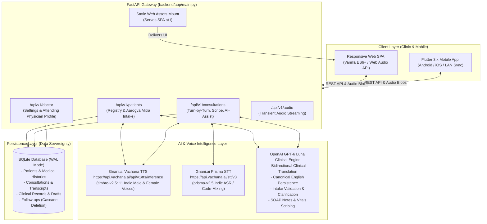

# SwasthyaSetu (स्वास्थ्य सेतु)
### Multilingual Healthcare Communication & Ambient Clinical Scribe Platform

[](https://fastapi.tiangolo.com)
[](https://gnani.ai/)
[](https://openai.com/)
[](https://www.sqlite.org)
[](https://flutter.dev)
[](https://render.com)
[](LICENSE)

---

## 📌 Problem Statement (PS)

### The Language Discordance & Documentation Crisis in Indian Healthcare
In India's diverse healthcare ecosystem, over **70% of clinical consultations outside urban metropolises** encounter severe language discordance:
1. **Linguistic Diversity vs. Medical Standard**: India has 22+ officially recognized languages and hundreds of regional dialects. Rural and migrant patients articulate intense symptoms, pain chronology, and medical history exclusively in regional mother tongues (Hindi, Marathi, Gujarati, Bengali, Tamil, Telugu, Kannada, Malayalam, Punjabi, Odia). Conversely, physicians are trained in English, and hospital Electronic Health Records (EHR/EMR), prescriptions, and medico-legal audit documents must legally be recorded in canonical medical English.
2. **Diagnostic & Drug Dosage Risks**: Language barriers lead to misunderstood symptom onset, missed chronic drug allergies, wrong dosage instructions, and patient non-compliance.
3. **Severe Physician Burnout**: Outpatient Department (OPD) physicians examine 60–100 patients daily and lose 2–3 hours every day manually typing notes, vitals, and prescriptions, reducing face-to-face patient examination time.
4. **Inefficient Hospital Registration & Triage**: Traditional front-desk registration lacks automated vernacular triage, forcing doctors to re-ask repetitive baseline demographic and complaint questions during the clinical consultation.

---

## 💡 The SwasthyaSetu Solution

**SwasthyaSetu (स्वास्थ्य सेतु)** is an end-to-end, voice-first clinical communication and autonomous medical documentation platform engineered for Indian clinics, OPDs, and telemedicine. It bridges the doctor-patient linguistic divide on a single computer or smartphone through a **dual-loop AI architecture**:

- **Real-Time Speech-to-Speech Interpretation**: Doctors speak medical English (or their chosen language); patients hear fluent regional speech synthesized in authentic Indic accents matching gender via **Gnani.ai Vachana TTS**. Patients speak vernacular dialects transcribed by **Gnani.ai Prisma STT**; doctors receive instant medical English transcripts and audio.
- **Autonomous SOAP Clinical Documentation**: Live consultation audio is parsed by **OpenAI GPT-6 Luna** into structured clinical parameters: Subjective history, Objective vitals (BP, HR, SpO2, Temp, Wt, Ht), Clinical Assessment/Diagnosis, Structured Prescriptions (drug, dosage, frequency, duration, food timing), and Follow-up instructions.
- **Conversational AI Triage (Aarogya Mitra • आरोग्य मित्र)**: Front-desk virtual voice intake in 11 Indian languages that validates patient utterances in real-time, reprompts if off-topic, and pre-generates a canonical English clinical briefing for the attending physician.
- **Physician-in-the-Loop Governance**: Strict compliance with medical AI safety guidelines. The AI assistant drafts notes and structures data, but the attending doctor retains complete edit authority and signs off before official EHR persistence and PDF printing.

---

## 🔄 Four Dedicated Operating Modes

SwasthyaSetu provides four specialized workflows tailored for clinical environments:

```
┌─────────────────────────────────────────────────────────────────────────────────┐
│                           SWASTHYASETU CLINICAL MODES                           │
├──────────────────────────┬──────────────────────────┬───────────────────────────┤
│ Mode 1: AI Patient Intake│ Mode 2: Turn-by-Turn     │ Mode 3: Ambient Scribe    │
│ (Aarogya Mitra Voice)    │ (Two-Way Interpretation) │ (Passive Room Diarization)│
│  - 11 Indian Languages   │  - Doctor: English       │  - Continuous Recording   │
│  - 5-step triage voice   │  - Patient: Indic Dialect│  - Multi-speaker SOAP     │
│  - Real-time validation  │  - Live Speech Synthesis │  - Auto-Vitals & Rx Plan  │
└──────────────────────────┴──────────────────────────┴───────────────────────────┘
                                       │
                                       ▼
                       Mode 4: Doctor AI Voice Scribe
                      (Dictate Vitals & Exam Findings)
```

### Mode 1: Conversational AI Patient Intake (आरोग्य मित्र / Aarogya Mitra)
- **Endpoints**: `POST /api/v1/patients/intake/validate` & `POST /api/v1/patients/intake`
- **Workflow**:
  1. Patient selects their native language from an interactive visual selector across 11 Indic languages.
  2. Virtual assistant **Aarogya Mitra** speaks questions aloud via **Gnani.ai Vachana Female TTS**.
  3. Patient speaks naturally; the system extracts and validates Name, Age, Gender, Mobile Number, Chief Complaint, Duration, Chronic Illnesses, and Drug Allergies.
  4. Real-time LLM validation detects off-topic answers (e.g., weather complaints) and politely reprompts in the patient's language.
  5. Automatically pre-populates a canonical English **Clinical Triage Card** ready for the attending physician.

### Mode 2: Bilingual Turn-by-Turn Consultation
- **Endpoint**: `POST /api/v1/consultations/{id}/turns` (Audio or Text)
- **Workflow**:
  1. **Doctor Speaks**: Captured in English ➔ Contextually translated to patient's native dialect by GPT-6 Luna ➔ Synthesized aloud via **Gnani Vachana Indic TTS**.
  2. **Patient Speaks**: Captured in native dialect via **Gnani Prisma STT** ➔ Contextually translated to medical English by GPT-6 Luna ➔ Displayed to doctor with confidence scores.
  3. Includes live audio equalizer visualizers, manual text override, and transcript editing.

### Mode 3: Ambient Background Clinical Scribe Mode
- **Endpoint**: `POST /api/v1/consultations/{id}/scribe`
- **Workflow**:
  1. The physician taps **Start Scribing** once at the start of the examination and places the device on the clinic desk.
  2. The system continuously listens to natural doctor-patient dialogue during physical exams without manual turn-taking.
  3. Background multi-speaker diarization separates doctor instructions from patient answers.
  4. Autonomously synthesizes a complete **SOAP Clinical Note** (Subjective, Objective, Assessment, Plan), extracts vitals, structures prescriptions, and suggests follow-up intervals.

### Mode 4: Doctor AI Voice Scribe Assistant Mode
- **Endpoint**: `POST /api/v1/consultations/{id}/ai-assist`
- **Workflow**:
  1. Doctors click the mic or text input on the clinical draft screen to quickly dictate vital signs (e.g., *"Blood pressure 130 over 85, pulse 76, temperature 98.6 Fahrenheit, weight 68 kg, SpO2 99%"*) or physical exam observations.
  2. The LLM extracts and updates structured vitals fields, differential diagnoses, or drug instructions in the active draft instantaneously.

---

## 🛠️ Technology Stack & Specific APIs Used

| Component / Layer | Technology / Service | Specific Model / Version | Exact API Endpoint / Method | Purpose in SwasthyaSetu |
|---|---|---|---|---|
| **Voice Synthesis (TTS)** | **Gnani.ai Vachana TTS** | `timbre-v2.5` (linear_pcm 16kHz WAV) | `POST https://api.vachana.ai/api/v1/tts/inference` | Generates 11 authentic Indian male and female regional voices with native phonetics. |
| **Speech Recognition (STT)** | **Gnani.ai Prisma STT** | `prisma-v2.5` | `POST https://api.vachana.ai/stt/v3` | Transcribes 11 Indian languages with high noise tolerance and code-mixing (Hinglish/Marathish). |
| **Resilient STT Fallback** | OpenAI Whisper | `whisper-1` | `POST https://api.openai.com/v1/audio/transcriptions` | Automatic seamless failover if primary STT experiences latency or connection issues. |
| **Clinical Reasoning, Translation & Scribing** | **OpenAI GPT-6 Luna** | `gpt-6-luna` | Structured Outputs (`response_format: json_schema`) | Powers bidirectional clinical translation, canonical English archival, conversational triage validation, ambient SOAP scribing, vitals normalization, and prescription parsing. |
| **Backend Framework** | **FastAPI** | Python 3.10+ / Uvicorn ASGI | Dynamic REST API & Static Asset Mount | High-throughput asynchronous routing, CORS handling, and streaming audio responses. |
| **Database & ORM** | **SQLAlchemy 2.0 (Async) + aiosqlite** | SQLite 3 in WAL Mode | Local SQLite database file (`swasthyasetu.db`) | Zero-latency local data sovereignty, relational integrity, and cascade deletion of patient records. |
| **Web Frontend** | **Vanilla ES6+ SPA** | HTML5, CSS3, Web Audio API | Hosted directly from `backend/frontend/` at `/` | Zero build step, zero npm bloat, low-latency browser audio recording and playback. |
| **Mobile Application** | **Flutter 3.x** | Dart 3.x | Native Android / iOS / Desktop client | Mobile clinical companion with offline support and local network (LAN) sync. |

---

## 🗣️ Supported Indic Languages & Authentic Voice Personas

SwasthyaSetu supports 11 Indian languages with dedicated male and female voice personas mapped to regional phonetics via **Gnani.ai Timbre v2.5**:

| Language Code | Language | Native Script | Male Voice (Doctor Persona) | Female Voice (Aarogya Mitra / Patient Persona) |
|---|---|---|---|---|
| `hi-IN` | Hindi | हिन्दी | **Deepak** | **Nalini** |
| `mr-IN` | Marathi | मराठी | **Omkar** | **Kaveri** |
| `en-IN` | Indian English | English | **Deven** | **Devika** |
| `gu-IN` | Gujarati | ગુજરાતી | **Nirav** | **Dhwani** |
| `bn-IN` | Bengali | বাংলা | **Tanmay** | **Mithu** |
| `ta-IN` | Tamil | தமிழ் | **Saravanan** | **Kavitha** |
| `te-IN` | Telugu | తెలుగు | **Chaitanya** | **Sandhya** |
| `kn-IN` | Kannada | ಕನ್ನಡ | **Gopal** | **Shweta** |
| `ml-IN` | Malayalam | മലയാളം | **Manoj** | **Arya** |
| `pa-IN` | Punjabi | ਪੰਜਾਬੀ | **Amrit** | **Kaur** |
| `or-IN` | Odia | ଓଡ଼ିଆ | **Subhas** | **Ananya** |

---

## 🏗️ System Architecture



---

## 🗄️ Relational Database Schema & Data Models

All clinical records are managed using asynchronous SQLAlchemy with SQLite in **Write-Ahead Logging (WAL)** mode for concurrent high-speed reads and writes:

- **Doctor**: Profiles attending physician credentials (`name`, `credentials`, `primary_language`, `spoken_languages`).
- **Patient**: Patient demographics (`full_name`, `age`, `gender`, `phone_number`, `preferred_language`, `chief_complaint`).
- **MedicalHistory**: Past chronic medical illnesses and known drug allergies.
- **Consultation**: Active or completed doctor-patient encounters (`doctor_id`, `patient_id`, `status`, `mode`).
- **Transcript**: Granular turn-by-turn dialogue preserving `speaker`, `source_text`, `translated_text`, `canonical_english`, audio duration, and confidence.
- **ConsultationDraft**: Pre-finalization clinical drafts holding parsed SOAP components, vitals JSON, and prescriptions JSON.
- **ClinicalRecord**: Approved, finalized, immutable legal EHR records ready for medical audits.
- **Followup**: Scheduled follow-up dates with automated SMS reminder dispatch.

> [!NOTE]
> Deleting a patient triggers a cascading cleanup that permanently removes all associated consultations, transcripts, drafts, clinical records, and follow-ups.

---

## 🔌 API Endpoints Catalog

| HTTP Method | Route | Description |
|---|---|---|
| `GET` | `/health` | Service health status, database connection, LAN IP, and AI model configurations. |
| `GET` | `/api/v1/patients` | Search and list registered patients by name or phone number. |
| `POST` | `/api/v1/patients` | Manually register a new patient. |
| `POST` | `/api/v1/patients/intake/validate` | Real-time AI validation and conversational feedback for intake questions. |
| `POST` | `/api/v1/patients/intake` | Complete 5-step Aarogya Mitra intake and create patient with medical history. |
| `GET` | `/api/v1/patients/{id}` | Retrieve patient profile, medical history, and summary. |
| `DELETE` | `/api/v1/patients/{id}` | Permanently delete patient and all cascading consultations/records. |
| `GET` | `/api/v1/patients/{id}/reports` | Retrieve all historical signed clinical reports for a patient. |
| `POST` | `/api/v1/consultations` | Initialize a new consultation session. |
| `GET` | `/api/v1/consultations/{id}` | Get consultation details and current status. |
| `POST` | `/api/v1/consultations/{id}/turns` | Process a turn-by-turn audio/text dialogue turn (bilingual interpretation). |
| `POST` | `/api/v1/consultations/{id}/scribe` | Process continuous ambient room recording for automated SOAP drafting. |
| `POST` | `/api/v1/consultations/{id}/draft` | Manually trigger or refresh AI clinical draft generation from transcripts. |
| `GET` | `/api/v1/consultations/{id}/draft` | Retrieve the active clinical draft (SOAP notes, vitals, prescriptions). |
| `PATCH` | `/api/v1/consultations/{id}/draft` | Doctor edits to the clinical draft prior to final approval. |
| `POST` | `/api/v1/consultations/{id}/ai-assist` | Doctor AI Voice Scribe dictation endpoint for vitals and examination notes. |
| `POST` | `/api/v1/consultations/{id}/approve` | Attending physician sign-off committing draft into finalized clinical record. |
| `POST` | `/api/v1/consultations/{id}/followups` | Schedule patient follow-up appointment and dispatch SMS reminder. |
| `GET` | `/api/v1/doctor/settings` | Retrieve active doctor profile and clinic display configuration. |
| `PUT` | `/api/v1/doctor/settings` | Update doctor name, credentials, and languages. |
| `POST` | `/api/v1/audio/transient` | Store temporary audio blob for low-latency browser streaming. |

---

## 📖 How to Use the Web Interface (Step-by-Step)

1. **Step 1: Launch Conversational AI Intake (Aarogya Mitra)**
   - Click **"+ Onboard Patient"** on the dashboard.
   - Choose the patient's language from the 11 interactive language bubbles.
   - Virtual assistant **Aarogya Mitra** guides the patient through Name, Age/Gender, Phone, Chief Complaint, and Allergies with audible speech synthesis via Gnani TTS.
2. **Step 2: Real-Time AI Validation & Triage**
   - Answers are validated instantaneously by the clinical LLM.
   - Clinical summaries are canonicalized into English on the live triage card.
   - Click **"Start Doctor Consultation"** to proceed to the clinical room.
3. **Step 3: Conduct Consultation (Turn-by-Turn or Ambient Scribe)**
   - **Conversation Mode**: Click the mic to take turns. The doctor speaks English, the patient hears their mother tongue; the patient speaks vernacular, the doctor receives clinical English audio and text.
   - **Ambient Scribe**: Click the **"Ambient Scribe Mode"** tab, tap **"Start Recording"** once, and converse freely during physical examinations.
4. **Step 4: Generate SOAP Report & Dictate Vitals with Doctor AI Scribe**
   - Click **"Generate AI Report"** to structure the entire session into Subjective, Objective, Assessment, and Plan (Prescription medications).
   - On the draft review screen, use the **"Talk to AI Clinical Assistant"** input or mic to dictate vitals (e.g., *"BP 125/80, pulse 74, weight 65 kg, temp 98.6"*) or physical examination findings.
5. **Step 5: Approve, Sign, and Print Prescription**
   - Doctor reviews and modifies any clinical fields.
   - Click **"Approve & Sign Clinical Record"**.
   - Print an official hospital prescription with credentials or schedule follow-up appointments with SMS reminders.

---

## 🚀 Local Development & Setup

### Prerequisites
- **Python**: 3.10, 3.11, or 3.12
- **Flutter**: 3.x (optional, for mobile client)
- **Git**

### 1. Clone & Set Up Backend
```bash
# Clone the repository
git clone https://github.com/swapnilnaik29/SwasthyaSetu.git
cd SwasthyaSetu/backend

# Create virtual environment
python -m venv .venv

# Activate virtual environment
# Windows PowerShell:
.\.venv\Scripts\Activate.ps1
# Linux / macOS:
source .venv/bin/activate

# Install dependencies
pip install -r requirements.txt

# Configure environment variables
cp .env.example .env
# Edit .env and supply your GNANI_API_KEY and OPENAI_API_KEY
```

### 2. Start the Backend Server
```bash
uvicorn app.main:app --host 0.0.0.0 --port 8000 --reload
```
- **Web Interface (SPA)**: Open [http://localhost:8000/](http://localhost:8000/) in your browser.
- **Interactive Swagger Docs**: Open [http://localhost:8000/docs](http://localhost:8000/docs).
- **Alternative Redoc**: Open [http://localhost:8000/redoc](http://localhost:8000/redoc).

### 3. Run Automated Tests
```bash
cd backend
python -m pytest tests/test_consultation_flow.py tests/test_provider_adapters.py -v
```

### 4. Run Flutter Mobile App (Optional)
```bash
cd app
flutter pub get
flutter run
```
> **Tip for Local Testing**: Tap the **SwasthyaSetu** logo on the dashboard screen **10 times** to enter your computer's local Wi-Fi IP address (e.g. `http://192.168.1.4:8000`).

---

## ☁️ Deployment on Render Cloud

The backend and web frontend are unified inside `backend/` to deploy seamlessly as a single Render Web Service:

1. Log in to [Render Dashboard](https://dashboard.render.com/).
2. Click **New +** ➔ **Web Service**.
3. Connect your repository `swapnilnaik29/SwasthyaSetu`.
4. Configure service settings:
   - **Root Directory**: `backend`
   - **Environment**: `Python`
   - **Build Command**: `pip install -r requirements.txt`
   - **Start Command**: `uvicorn app.main:app --host 0.0.0.0 --port $PORT`
   - **Instance Type**: `Free`
5. Configure Environment Variables:
   - `PYTHON_VERSION`: `3.11.9`
   - `DATABASE_URL`: `sqlite+aiosqlite:///swasthyasetu.db`
   - `GNANI_API_KEY`: *(Your Gnani.ai API Key)*
   - `OPENAI_API_KEY`: *(Your OpenAI API Key)*
6. Click **Create Web Service**. Render will deploy the application and serve both the web frontend and API.

---

## 🔒 Security, Privacy & Clinical Compliance

1. **Local Data Sovereignty**: All clinical databases operate with SQLite WAL mode stored on the device or hospital private server, ensuring patient records never leave the local boundary without authorization.
2. **Standardized Clinical English EHR**: Regional vernacular speech is translated and archived in standard medical English, preventing transcription ambiguities during medico-legal audits.
3. **Immutable Audit Trail**: Every consultation maintains the original vernacular transcript, canonical English translation, acoustic metrics, physician modifications, and cryptographic approval timestamps.
4. **Physician Oversight**: Fully compliant with medical AI governance standards; AI models never prescribe or finalize diagnoses autonomously.

---

## 👨‍💻 Project Credits

- **Project**: SwasthyaSetu (स्वास्थ्य सेतु)
- **Developer**: **Swapnil Naik**
- **LinkedIn**: [https://www.linkedin.com/in/swapnilnaik29/](https://www.linkedin.com/in/swapnilnaik29/)
- **GitHub Repository**: [https://github.com/swapnilnaik29/SwasthyaSetu](https://github.com/swapnilnaik29/SwasthyaSetu)
- **Primary Voice AI**: [Gnani.ai](https://gnani.ai/) Voice Intelligence Engine (Vachana TTS & Prisma STT)
