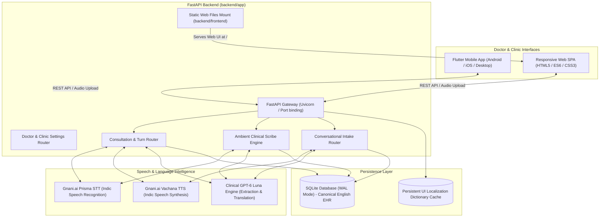

# SwasthyaSetu (स्वास्थ्यसेतु)
### Multilingual Healthcare Communication & Ambient Clinical Scribe Platform
**Gnani.ai AI Internship Hackathon Submission Project**

[](https://gnani.ai/)
[](https://fastapi.tiangolo.com)
[](https://flutter.dev)
[](https://render.com)
[](https://www.sqlite.org)
[](https://python.org)

---

## Executive Summary

In India's diverse healthcare ecosystem, over **70% of clinical consultations** outside urban metropolises face language discordance between doctors (who predominantly practice and document in English) and rural or migrant patients who speak regional Indian languages (Hindi, Marathi, Gujarati, Bengali, Tamil, Telugu, Kannada, Malayalam, Punjabi, Odia). This barrier leads to misdiagnoses, poor medication adherence, patient anxiety, and administrative burnout.

**SwasthyaSetu** bridges this critical healthcare divide on a single doctor-held smartphone or computer. Powered by **Gnani.ai Speech Intelligence (Prisma STT & Vachana TTS)** and clinical language models, SwasthyaSetu provides an end-to-end clinical workflow:
1. **Interactive Conversational Patient Onboarding** in 11 Indian languages.
2. **Turn-by-Turn Bidirectional Consultation** with instant voice translation.
3. **Ambient Clinical Scribe Mode** that passively listens to continuous natural consultation dialogue and auto-generates structured clinical reports and patient vitals.
4. **Physician-in-the-Loop Review** ensuring patient safety and regulatory compliance.
5. **Canonical English EHR Archival & Automated PDF Report Printing**.

---

## Key Features

### 1. Conversational AI Patient Intake (11 Indian Languages)
- Patients select their native language via an interactive visual bubble selector: **Hindi (हिन्दी), Marathi (मराठी), Gujarati (ગુજરાતી), Bengali (বাংলা), Tamil (தமிழ்), Telugu (తెలుగు), Kannada (ಕನ್ನಡ), Malayalam (മലയാളം), Punjabi (ਪੰਜਾਬੀ), Odia (ଓଡ଼ିଆ), or Indian English**.
- Intake assistant **Aarogya Mitra** speaks questions aloud via **Gnani Vachana Female TTS**.
- Patients speak or type answers naturally; the system validates name, age, gender, 10-digit mobile number, chief complaint, duration, past medical history, and allergies in real time.
- Displays a **Live Autofilled Intake Form** in the patient's language and synthesizes a **Clinical Triage Briefing** in English for the attending doctor.

### 2. Turn-by-Turn Bilingual Consultation
- Designed for structured doctor-patient consultations:
  - **Patient Speaks**: Captured via Gnani STT in native dialect ➔ Translated to English for the doctor ➔ Displayed with confidence metrics.
  - **Doctor Speaks**: Captured in English (or doctor's preferred language) ➔ Translated to the patient's language ➔ Synthesized aloud via Gnani TTS.
- Includes manual text override, transcription editing, and soundwave equalizer animations.

### 3. Ambient Clinical Scribe Mode
- Place the smartphone or laptop on the clinic desk and tap **Start Scribing**.
- Doctor and patient converse freely without taking manual turns.
- Audio is transcribed using high-accuracy speech recognition, translated contextually into English, and analyzed to extract:
  - **Patient Vitals**: Blood Pressure (BP), Heart Pulse (BPM), Weight (kg), Height (cm), Temperature (°F), and SpO2 (%).
  - **Clinical Subjective History**: Chief complaints, symptom chronology, lifestyle triggers.
  - **Physician Assessment & Diagnosis**: Primary and differential clinical diagnoses.
  - **Prescription Orders**: Drug name, dosage, frequency, route, duration, and food timing instructions.
  - **Recommended Follow-up Date & Instructions**.

### 4. Physician-in-the-Loop Review & Confirmation
- Adheres strictly to healthcare AI safety standards: **The AI assistant never prescribes or diagnoses autonomously**.
- Doctors review all extracted vitals and clinical drafts, dictate adjustments using speech or text, add or remove medications, and officially approve the record.

### 5. Canonical English EHR Storage & Instant PDF Printing
- All official patient consultations and EHR documents are persisted in **standardized clinical English** in a high-performance SQLite WAL database, ensuring cross-hospital interoperability.
- Features a **Print / Save PDF** engine formatting clinical reports for official hospital documentation.

---

## Gnani.ai Voice AI Integration

SwasthyaSetu utilizes **Gnani.ai Speech Intelligence APIs** for Indian vernacular speech processing:

| Feature | Gnani Service | Model / Configuration | Voice Persona |
|---|---|---|---|
| **Speech-to-Text (STT)** | Gnani Prisma / Vachana STT v3 | 16kHz Linear PCM Audio | Auto-language detection across 11 Indic dialects |
| **Intake Voice (TTS)** | Gnani Vachana TTS | 16kHz Wav Streaming | **Female** (Nalini / Kaveri / Devika) |
| **Doctor Voice (TTS)** | Gnani Vachana TTS | 16kHz Wav Streaming | **Male** (Deven / Madhav) |
| **Patient Voice (TTS)** | Gnani Vachana TTS | Dynamic gender matching | Matches patient gender from intake form |

---

## Supported Indic Languages

| Language Code | Language | Native Script | Onboarding UI | Voice STT | Voice TTS |
|---|---|---|---|---|---|
| `hi-IN` | Hindi | हिन्दी | Native | Supported | Supported |
| `mr-IN` | Marathi | मराठी | Native | Supported | Supported |
| `gu-IN` | Gujarati | ગુજરાતી | Native | Supported | Supported |
| `bn-IN` | Bengali | বাংলা | Native | Supported | Supported |
| `ta-IN` | Tamil | தமிழ் | Native | Supported | Supported |
| `te-IN` | Telugu | తెలుగు | Native | Supported | Supported |
| `kn-IN` | Kannada | ಕನ್ನಡ | Native | Supported | Supported |
| `ml-IN` | Malayalam | മലയാളം | Native | Supported | Supported |
| `pa-IN` | Punjabi | ਪੰਜਾਬੀ | Native | Supported | Supported |
| `or-IN` | Odia | ଓଡ଼ିଆ | Native | Supported | Supported |
| `en-IN` | Indian English | English | Native | Supported | Supported |

---

## System Architecture



---

## Repository Structure

```text
SwasthyaSetu/
├── backend/                  # FastAPI Python Backend & Static Web Assets
│   ├── app/
│   │   ├── api/routes/       # Endpoints: audio, consultations, doctor, patients, cache
│   │   ├── core/             # Configuration, logging, security
│   │   ├── db/               # Async SQLAlchemy session (SQLite WAL mode initialization)
│   │   ├── models/           # ORM models (Doctor, Patient, Consultation, Draft, etc.)
│   │   ├── schemas/          # Pydantic v2 schemas for strict clinical validation
│   │   ├── services/
│   │   │   ├── speech/       # Gnani Prisma STT & Vachana TTS adapters
│   │   │   ├── translation/  # GPT-6 Luna translation & UI dictionaries
│   │   │   └── records/      # Scribe & EHR draft extraction engine
│   │   └── main.py           # Application entrypoint & static frontend mount
│   ├── frontend/             # Single-Page Web Frontend (HTML, CSS, JS)
│   │   ├── css/style.css     # Clean clinical styling & responsive layout
│   │   ├── js/app.js         # Core application logic & speech pipeline
│   │   ├── js/api.js         # Backend REST API client
│   │   ├── js/audio.js       # Browser audio recorder & streaming player
│   │   ├── js/i18n.js        # 11-language localized UI dictionary
│   │   └── index.html        # Web app entrypoint
│   ├── tests/                # Automated pytest test suite
│   ├── Procfile              # Render web process definition
│   ├── render.yaml           # Render infrastructure blueprint
│   ├── runtime.txt           # Python 3.11.9 runtime pinning
│   └── requirements.txt      # Backend Python dependencies
├── app/                      # Flutter Mobile Application
│   ├── lib/
│   │   ├── core/             # API client, audio service, i18n, report printer
│   │   ├── models/           # Dart data models
│   │   ├── screens/          # Dashboard, Onboarding, Consultation, Draft Review
│   │   └── main.dart         # Flutter app entrypoint
│   └── pubspec.yaml          # Flutter dependencies
├── docs/                     # Architecture & demonstration guides
├── render.yaml               # Root Render blueprint (points to backend/)
└── README.md                 # Project documentation
```

---

## Deployment on Render Cloud

The backend and web frontend are unified inside `backend/` to deploy seamlessly as a single Render Web Service.

### Quick Deploy via Render Blueprint

1. Fork or push this repository to GitHub.
2. Log in to [Render Dashboard](https://dashboard.render.com/).
3. Click **New +** ➔ **Blueprint**.
4. Connect your GitHub repository. Render automatically reads `render.yaml`.
5. Configure the following environment variables under **Environment**:
   - `GNANI_API_KEY`: Your Gnani.ai API access token.
   - `OPENAI_API_KEY`: Your OpenAI API key for GPT-6 Luna clinical extraction.
6. Click **Apply**. Render will automatically:
   - Install dependencies from `requirements.txt`.
   - Start the service using `uvicorn app.main:app --host 0.0.0.0 --port $PORT`.
   - Serve the complete web frontend at `https://<your-subdomain>.onrender.com/`.
   - Expose the REST API at `https://<your-subdomain>.onrender.com/api/v1`.

### Manual Render Web Service Setup (Alternative)

If creating a manual Web Service on Render:
- **Root Directory**: `backend`
- **Environment**: `Python`
- **Build Command**: `pip install -r requirements.txt`
- **Start Command**: `uvicorn app.main:app --host 0.0.0.0 --port $PORT`
- **Environment Variables**:
  - `PYTHON_VERSION`: `3.11.9`
  - `DATABASE_URL`: `sqlite+aiosqlite:///swasthyasetu.db`
  - `GNANI_API_KEY`: `<Your Gnani Key>`
  - `OPENAI_API_KEY`: `<Your OpenAI Key>`

---

## Local Development & Setup

### 1. Prerequisites
- **Python**: 3.11 or higher
- **Flutter**: 3.24+ (if running the mobile application)
- **Git**

### 2. Backend Setup

```bash
# Clone the repository
git clone https://github.com/swapnilnaik29/SwasthyaSetu.git
cd SwasthyaSetu/backend

# Create virtual environment
python -m venv .venv

# Activate virtual environment
# Windows PowerShell:
.\.venv\Scripts\Activate.ps1
# Linux / macOS:
source .venv/bin/activate

# Install dependencies
pip install -r requirements.txt

# Create .env file with your API keys
cp .env.example .env
# Edit .env and supply GNANI_API_KEY and OPENAI_API_KEY

# Start backend server
uvicorn app.main:app --host 0.0.0.0 --port 8000 --reload
```

- Web Interface: Open `http://localhost:8000/` in your browser.
- Interactive API Docs: Open `http://localhost:8000/docs`.

### 3. Flutter Mobile App Setup

```bash
cd SwasthyaSetu/app

# Fetch Flutter dependencies
flutter pub get

# Run on connected physical device or emulator
flutter run
```

> **Tip for Local Testing**: Tap the **SwasthyaSetu** title on the dashboard screen **10 times** to open the developer dialog and enter your computer's local Wi-Fi IP address (e.g. `http://192.168.1.5:8000`).

### 4. Running Automated Tests

```bash
cd SwasthyaSetu/backend
.venv\Scripts\python -m pytest tests/test_consultation_flow.py tests/test_provider_adapters.py -v
```

All integration tests covering Turn-by-Turn consultations, Ambient Scribing, Gnani adapters, and record finalization run automatically.

---

## Security & Clinical Compliance

1. **Local Data Sovereignty**: All clinical databases operate with SQLite WAL mode stored on the device or hospital private cloud.
2. **Canonical EHR Integrity**: Regional conversations are translated and archived in standard medical English, avoiding transcription ambiguities during medical audits.
3. **Audit Trail**: Every consultation preserves the original Indic transcript, the translated English transcript, audio metrics, physician modifications, and approval timestamps.

---

## Submission Credits

- **Project**: SwasthyaSetu (स्वास्थ्यसेतु)
- **Hackathon**: Gnani.ai AI Internship Hackathon
- **Developer**: Swapnil Naik
- **Primary Voice AI**: [Gnani.ai](https://gnani.ai/) Voice Intelligence Engine
