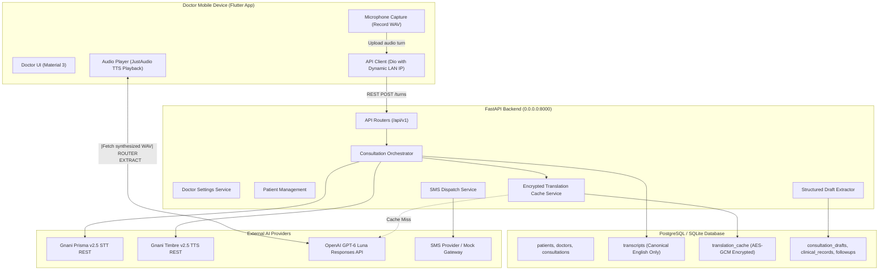
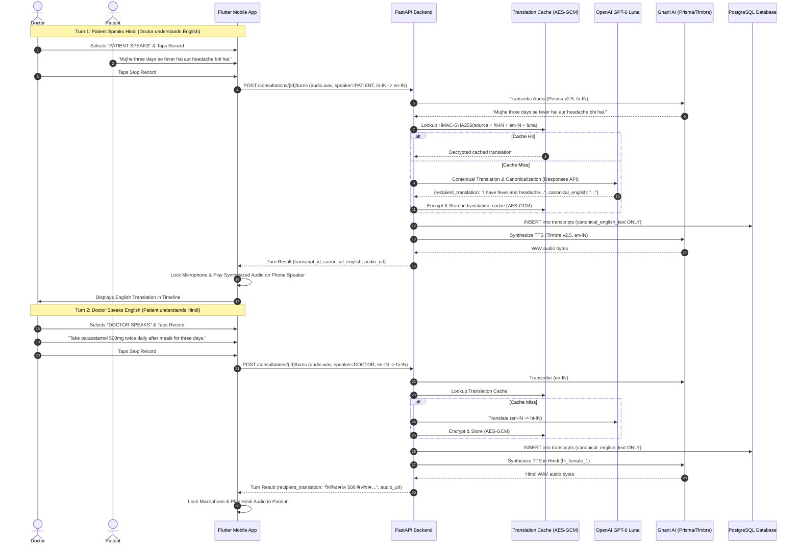
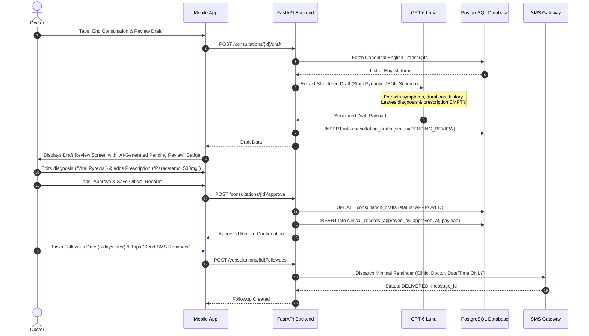

# SwasthyaSetu — System Architecture & Design Specification

SwasthyaSetu is a doctor-operated, single-phone multilingual healthcare communication and clinical documentation assistant designed to eliminate language barriers in doctor-patient consultations.

---

## 1. High-Level Architecture



---

## 2. Bidirectional Turn-Based Consultation Flow

The consultation operates in discrete, turn-based speech exchanges on a single doctor-held smartphone. The doctor manually designates the active speaker (**Patient** or **Doctor**) before each turn.



---

## 3. Canonical English Storage Architecture

### Rationale & Legal Integrity
In medical and hospital governance across India, medical records and prescriptions are legally canonicalized in standard English. Translating into regional languages transiently bridges the clinical gap, but persisting raw, unverified regional text into the canonical medical record introduces liability and audit discrepancies.

### Enforcement Rules
1. **Clinical Tables Exclusion**: The tables `transcripts`, `consultation_drafts`, and `clinical_records` strictly store canonical English text.
2. **Transient UI Display**: Recognized regional speech is returned transiently to the active consultation screen so the doctor can audit the speech recognition live.
3. **Encrypted Cache Exception**: The `translation_cache` table is the sole permitted exception to avoid repeat API calls. Cached non-English text is encrypted at rest using AES-GCM and indexed via keyed HMAC-SHA256.

---

## 4. Persistent Encrypted Translation Cache

```mermaid
flowchart TD
    Start([Speech Turn Recognized]) --> Norm[Normalize Safe Whitespace & NFC]
    Norm --> HMAC[Compute Keyed HMAC-SHA256 Hash]
    HMAC --> Lookup{Match in DB cache_key_hash?}
    Lookup -- Yes (Not Expired) --> Hit[Increment hit_count & Decrypt AES-GCM]
    Hit --> Return[Return Cached Translation (0 Model Calls)]
    Lookup -- No / Expired --> Call[Call GPT-6 Luna Responses API]
    Call --> Validate[Validate Strict Pydantic Schema]
    Validate --> Encrypt[Encrypt Target Text with AES-GCM]
    Encrypt --> Store[Store in DB with 90-day TTL]
    Store --> Return
```

---

## 5. Draft Generation & Approval Flow



---

## 6. Single-Device Audio Feedback Prevention

When recording and playback occur on a single smartphone:
- TTS playback through phone speaker can bleed directly into the microphone.
- **Solution implemented in `AudioService`**:
  * Audio playback triggers an automatic recording lock (`isPlaying = true`).
  * If recording is active when playback begins, recording is immediately stopped.
  * Start recording is prohibited while audio playback is active.
  * UI prominently displays: `"TTS Playing — Recording paused to prevent microphone echo"`.
