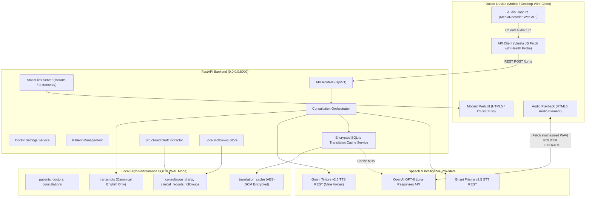
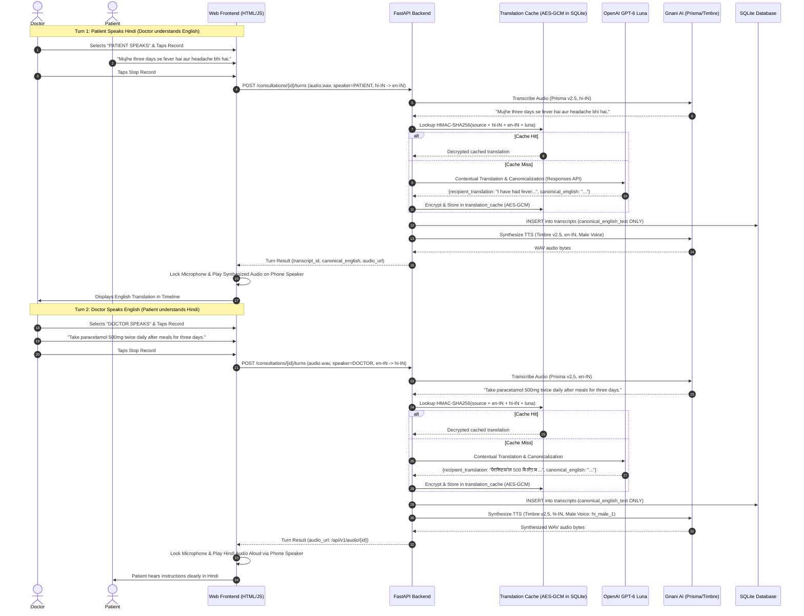

# SwasthyaSetu — System Architecture & Design Specification

SwasthyaSetu is a doctor-operated, single-device multilingual healthcare communication and clinical documentation assistant designed to eliminate language barriers in doctor-patient consultations.

---

## 1. High-Level Architecture



---

## 2. Bidirectional Turn-Based Consultation Flow

The consultation operates in discrete, turn-based speech exchanges on a single doctor-held device. The doctor manually designates the active speaker (**Patient** or **Doctor**) before each turn.



---

## 3. High-Performance SQLite Configuration

To ensure sub-second response times on local devices, SQLite is configured with Write-Ahead Logging (WAL) and memory optimization PRAGMAs:

```sql
PRAGMA journal_mode = WAL;         -- Concurrent reads during writes
PRAGMA synchronous = NORMAL;       -- Safe durability with reduced disk sync overhead
PRAGMA cache_size = -64000;        -- 64MB memory page cache
PRAGMA temp_store = MEMORY;        -- Temporary tables in RAM
PRAGMA foreign_keys = ON;          -- Referential integrity
```

Additionally, connection pooling (`httpx.AsyncClient` with keep-alives) is maintained across Gnani AI and OpenAI API calls, eliminating TLS handshakes on every conversational turn.

---

## 4. Canonical English Storage Rule

Medical records must be searchable and auditable across doctors regardless of the language spoken during the consultation. Therefore:
1. All entries in the `transcripts` table store `canonical_english_text`. Non-English raw transcripts are never persisted in the clinical record.
2. All entries in `consultation_drafts` and `clinical_records` store structured entities (symptoms, duration, diagnosis, medications, instructions) strictly in canonical medical English.

---

## 5. Security & Encryption at Rest

1. **Translation Cache**:
   - `lookup_hash`: `HMAC-SHA256(normalized_source_text + src_lang + tgt_lang + model, hmac_key)`
   - `encrypted_translation`: AES-256-GCM encrypted ciphertext with 12-byte random nonce and 16-byte authentication tag.
2. **Clinical Records**:
   - Stored locally on encrypted volume or protected database file.
   - Physician approval is strictly signed with doctor ID and timestamp.
